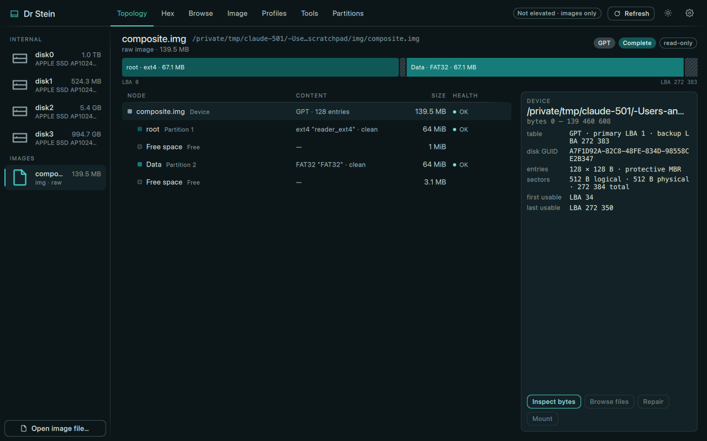

# Dr Stein

Disk and disk-image multitool: the desktop front-end of
[libstein](https://github.com/streamx3/libstein). One Qt 6 / QML codebase for
Linux, macOS and Windows; every byte-level decision is the library's.



The title bar is drawn by the app on every platform (traffic lights on macOS,
caption chips on Windows, VS Code's caption buttons on Linux); four palettes (teal, blurple, Apple blue,
grey), dark and light.

Seven views, translated from the Claude Design prototype in
[`doc/design/mockup/`](doc/design/mockup/):

| View | What it does |
|---|---|
| Topology | byte-proportional bar, the probe tree (table, partitions, containers, volumes), a details card with usage, diagnostics and actions; a locked LUKS container unlocks in place (the passphrase stays in memory for the session, the unlocked master key is reused by later probes) and its payload appears as a row to browse or mount; a container the library cannot open says why instead |
| Hex | every on-disk structure the library parses (GPT headers and entries, superblocks, boot sectors) next to its bytes; field edits preview on an overlay, checksums can be recomputed, nothing is written before you say so |
| Browse | files inside ext4, FAT, exFAT, NTFS, HFS+, APFS, XFS, btrfs, ISO, UDF, SquashFS, EROFS and F2FS, in images, LUKS containers or LVM volumes, without mounting; shown in columns as in Finder (one per folder on the path, then the selected folder's contents) or, picked in Settings, as a folder tree beside a table; the panes and the columns are resized by dragging and remember their widths; the arrow keys walk the folders and the selected file is previewed as text, hex or a picture, read and decoded off the UI thread (the "auto" check on the preview card, also in Settings, turns that off: a file is then previewed only on "Preview this file"); hash, copy out, drag out, or mount it for the OS under a mount point named after the volume label, with Reveal in Finder / Show in Explorer |
| Image | create `.stein` or raw images of a whole device or of one partition (used blocks only, LZ4, split, encrypted); partition images record where they came from and restore into a partition; restore any supported container to a disk; verify; manage key slots |
| Profiles | the dr_stein one-button case: a disk identity plus an image, three buttons, all dry-runnable |
| Tools | surface scan (read-only) and the fake-flash capacity test (destructive, confirmed by typing the device name) |
| Partitions | create / add (on MBR, logical partitions inside the extended container too) / edit / delete / repair (GPT copies, the MBR EBR chain) / wipe on an operation stack with a live preview; applied in one pass, after which a real disk's table is re-read by the OS |

Everything opens read-only. Writes go through the library's operation stack or
an explicit, identity-repeating confirmation; while a write runs, everything but
Cancel is locked. Disks and mounts appearing or vanishing are picked up by the
OS's own notifications (DiskArbitration, inotify + /proc/self/mounts,
WM_DEVICECHANGE). Without root or Administrator
rights the app lists disks but can only open image files; it says so in the top
bar.

## Building

Requirements: CMake ≥ 3.25, Ninja, a C++23 compiler (Apple clang 15+, GCC 13+,
Clang 19+, MSVC 2022), Python ≥ 3.11 (libstein's layout generator), Qt 6.7+
with the Quick, QuickControls2, QuickDialogs2 and Svg modules. Clang 18 on
Linux (Ubuntu 24.04's default) builds too, with libstein's bundled
`tl::expected` in place of the `std::expected` its libstdc++ hides, and a
configure-time warning asking for Clang 19.

Linux additionally needs `pkg-config` and `libfuse3-dev` for libstein's FUSE
mount backend; without them the build still succeeds but mounting from the app
("Mount instead" in Browse, Mount in Topology) is unavailable. On Debian and
Ubuntu derivatives:

```sh
sudo apt install build-essential cmake ninja-build pkg-config python3 libfuse3-dev
```

```sh
git clone --recurse-submodules https://github.com/streamx3/dr_stein
cd dr_stein
export QT_ROOT=$HOME/Qt/6.10.2/macos      # wherever Qt's lib/cmake lives
cmake --preset debug
cmake --build --preset debug
ctest --preset debug                     # the core's unit tests
```

The app lands in `build/debug/src/app/` (`Dr Stein.app` on macOS,
`Dr Stein.exe` on Windows, `dr-stein` on Linux). `cmake --preset core` builds
and tests the Qt-free core alone.

In Qt Creator the presets file does two things worth knowing. The Configure
Project page lists only the kits made from the presets (`debug`, `release`,
`core`, `ci`) and hides the regular ones; they can still be enabled later in
Projects mode. And the preset kits take Qt from `QT_ROOT`, which Qt Creator
reads from its own environment: set it under Preferences > Environment >
System (for example `QT_ROOT=$HOME/Qt/6.11.2/gcc_64`), then Build > Reload
CMake Presets. A kit's compiler must be one from the list above; Qt Creator
may pick Clang 18 on its own, which only builds through the fallback.

To work on a real disk, launch elevated; on macOS:

```sh
sudo "build/debug/src/app/Dr Stein.app/Contents/MacOS/Dr Stein"
```

On Linux "Not elevated · images only" in the top bar relaunches the app
through pkexec.

Image files (`.stein`, raw, split raw, qcow2, VHD, VHDX, VMDK, VDI, E01, DMG)
need no privileges and can be passed on the command line. The in-app relaunch
carries the selected source, the view, the preview switch and Browse's layout
along (`DRSTEIN_SOURCE`, `DRSTEIN_VIEW`, `DRSTEIN_PREVIEW`,
`DRSTEIN_BROWSE_LAYOUT`) and asks once for the passphrase of the first locked
container it finds; passphrases never enter the environment.

## Linux: install and uninstall

On Linux the app installs as one tree, `/opt/dr-stein`, that carries the Qt it
was built with: Mint 22 and Ubuntu 24.04 ship Qt 6.4.2, older than the 6.7 the
app needs, and the tree keeps its Qt where no other program loads it. The
usual way in is the Debian package:

```sh
QT_ROOT=$HOME/Qt/6.12.0/gcc_64 tools/package-deb.sh   # makes build/package/dr-stein_<version>_amd64.deb
sudo apt install ./build/package/dr-stein_<version>_amd64.deb
dr-stein                                                # or Dr Stein in the applications menu
sudo apt remove dr-stein
```

`tools/package-deb.sh` runs as yourself. `QT_ROOT` names a Qt 6.7 or later kit
from the Qt installer (the directory that holds `bin/`, `lib/` and
`plugins/`), and the package carries that Qt, whatever its version; so far
only 6.12.0 has been packaged. The script builds a Release tree from the
`package` preset in `build/package` (or the directory given as its argument),
runs the core tests, makes the package with CPack and prints the exact
`apt install` command. It needs the kit's documentation, installed with Qt's
maintenance tool (the notices for the third-party code inside Qt are copied
from it), `libfuse3-dev` and `pkg-config` (it stops if libstein would build
without its FUSE mount backend), `dpkg-dev` (part of `build-essential`) and
`file`. Builds from git get their version from it: `0.1.1+git<date>.<time>.<hash>`
after the release tag, `~git…` before it, and `~dirty<time>` for uncommitted
changes; a shallow clone, or one without tags, is refused. Set `DEBFULLNAME`
and `DEBEMAIL` for the Maintainer field before giving the package to anyone.

The package is for Ubuntu 24.04, Mint 22, Debian 13 and later (its
dependencies have the `t64` names); so far it has run on Mint 22.3 only, and
has not yet been installed there with apt. It holds:

| Where | What |
|---|---|
| `/opt/dr-stein/` | `bin/dr-stein`, Qt's and libstein's libraries, Qt's plugins and QML modules |
| `/usr/bin/dr-stein` | a link to the binary, so `dr-stein` is on PATH |
| `/usr/share/` | the `.desktop` file, the icons, the manual page, and `doc/dr-stein/` with the licences |

apt brings in the system libraries the tree links to (X11 and xcb, GTK 3,
fontconfig, libfuse3 and others, listed by dpkg-shlibdeps when the package is
made) and recommends `pkexec` and `fuse3`. Dr Stein then sits in the
applications menu in the same section as GParted (`System;Filesystem;`), its
`.desktop` file lists the disk-image types so file managers offer it under
Open With, and `dr-stein disk.img` opens an image from a terminal. Without
root it opens image files only; "Not elevated · images only" in the top bar
relaunches it through pkexec for real disks. `sudo apt remove dr-stein` takes
all of it away again; your settings and profiles in `~/.config/dr_stein/`
stay.

Without a package, `cmake --install` makes the same tree, by default in
`/opt/dr-stein`, with the link, the `.desktop` file, the icons, the manual
page and the licences under `/usr/local`, and the `uninstall` target takes it
away:

```sh
cmake --preset release && cmake --build --preset release
sudo cmake --install build/release
sudo cmake --build build/release --target uninstall
```

The install refuses a prefix whose `lib/` is on the system library path (`/`,
`/usr`, `/usr/local`, or a directory `ld.so.conf` names) and will not write
over an installed dr-stein package: both use `/opt/dr-stein`, so have one or
the other. Configured with `-DDRSTEIN_DESKTOP_PREFIX=` (empty), everything
stays inside the prefix and there is no link on PATH, so `cmake --install
build/release --prefix ~/opt/dr-stein` needs no root. `uninstall` removes the
files `install_manifest.txt` lists and the directories the install created;
give it the `DESTDIR` the install had, if any. Without Qt's documentation,
configuring warns and the installed notices point at Qt's website instead.

The bundled Qt, with its image decoders (libpng, libjpeg-turbo, libtiff,
libwebp) and ICU, gets no security updates from the distribution, and Browse
decodes pictures from the images it opens, as root after the elevated
relaunch. Rebuild and reinstall the package when Qt publishes a patch
release. Only Qt's X11 platform plugin is bundled: on Wayland the app runs
through XWayland whatever `QT_QPA_PLATFORM` says, and without an X display it
says so and exits. The installed app ignores `QT_PLUGIN_PATH`,
`QML_IMPORT_PATH` and `QML2_IMPORT_PATH`, which point at another Qt.

## Layout

```
libstein/        the library, a git submodule (no Qt in it)
src/core/        drstein_core: Qt-free application logic over libstein, with doctest tests
src/qt/          QObject facades and models that QML binds to
src/app/         main.cpp and the QML module (Theme, components, views, dialogs)
src/app/icons/   the app icon (SVG, .ico, .icns; see its README) and the Linux caption-button glyphs
doc/design/      architecture, the mockup → QML translation notes, the mockup itself, screenshots
```

The architecture is described in
[`doc/design/01-application-architecture.md`](doc/design/01-application-architecture.md);
the theme tokens and the deviations from the mockup in
[`doc/design/02-ui-translation.md`](doc/design/02-ui-translation.md).

## Scripted runs

For smoke tests and screenshots without clicking (`dr-stein` is the binary:
`build/debug/src/app/dr-stein` on Linux, or from PATH once installed; on macOS
the executable inside `Dr Stein.app`):

```sh
DRSTEIN_VIEW=hex DRSTEIN_SCREENSHOT=/tmp/hex.png dr-stein disk.img
DRSTEIN_SCRIPT="Workspace.view='tools'; toolsView.tools.surfaceScan()" DRSTEIN_DELAY=8000 \
  DRSTEIN_SCREENSHOT=/tmp/scan.png dr-stein disk.img
DRSTEIN_SCHEME=light DRSTEIN_PALETTE=blue dr-stein     # teal | blurple | blue | grey
DRSTEIN_CHROME=native dr-stein                          # system title bar for this run
DRSTEIN_SOURCE=image:/abs/path/disk.img dr-stein disk.img other.img   # select that source at startup and ask once for its first locked container (what the elevated relaunch sets)
DRSTEIN_PREVIEW=0 DRSTEIN_VIEW=browse dr-stein disk.img   # file previews in Browse off (1: on) for this run; the stored setting is neither read nor written
DRSTEIN_BROWSE_LAYOUT=list DRSTEIN_VIEW=browse dr-stein disk.img   # Browse as a tree and a table (columns: the default) for this run; neither the layout nor the pane widths are stored
```

A script cannot press keys or click.
`browseView.keyPressed(Qt.Key_Down, 0, false)` runs Browse's key handler in
either layout, `browseView.moveSelection(n)` steps the selection and
`browseView.pageRows()` is what PageDown moves by. In the column layout
`browseView.browser.columnClicked(column, row)` is a click on a row (row -1:
the column's empty space) and `columnActivated(column, row)` a double-click.

`DRSTEIN_EXPORT_COMPOSITE=/tmp/disk.img build/debug/src/core/drstein_core_tests -tc="export*"`
writes a 139 MB GPT disk (ext4 + FAT32 from libstein's fixtures) to play with;
`DRSTEIN_EXPORT_MBR_COMPOSITE=/tmp/mbr.img` in the same command writes a 181 MB
MBR disk (FAT16, exFAT, an extended container holding an ext4 logical, free
space inside and after the container).

## Status

Every view is wired to the library and exercised against image files:
imaging (create, verify, restore byte-identical), partition editing with
apply on GPT and MBR (logical partitions included), repair of GPT copies, the
MBR EBR chain, FAT backup boot / FSInfo / FAT copies and exFAT boot regions,
hex edits with checksum repair, browsing in columns or in a list, by keyboard,
with previews of text, hex and pictures (read and decoded on a worker), hash
and copy out, LUKS1/2 unlock (a wrong passphrase is reported and forgotten;
Cancel stops the key derivation; the master key is cached per source for the
session so re-probes skip it; a container the library cannot open says why;
VeraCrypt trial decryption only on "Try VeraCrypt…"), NFS loopback mounts on
macOS named
after the volume label with Reveal in Finder and external unmounts noticed
within 2 s, surface scans, profile backups. The core tests (95 cases) run on a
GPT and an MBR composite disk built from libstein's fixtures and on its LUKS
fixtures. Written but not covered by a test: the OS re-read of the table after
an apply on a real disk, the elevated relaunch landing on a disk source
(tests and scripted runs use image sources), and Browse driven by real key
presses and a real pointer, in either layout (scripted runs and synthetic key
and mouse events drive the handlers; the way from the keyboard and the mouse
to them, and drag-out from a column, are left to a check by hand). Which
pictures preview depends on the decoders at hand: Qt alone reads PNG, JPEG,
GIF, BMP, ICO/CUR, PBM/PGM/PPM, XPM and SVG; macOS adds TIFF, WebP, HEIC,
AVIF, JPEG 2000 and ICNS through ImageIO; on Linux and Windows TIFF and WebP
need Qt's Image Formats add-on and HEIC has no decoder (on Linux, PNG, JPEG
and SVG previews have run; the preview work has not been built on Windows).
A picture without a decoder, or above 64 MiB,
shows as hex with a note; an SVG that would draw more than 100 000 elements
once its references are followed, or nests more than 128 levels deep, shows
as its source; text shows its first 64 KiB; audio and video are not previewed
(`doc/design/01-application-architecture.md` §10). The LUKS work and what is
left of it is in `doc/design/06-luks-on-macos.md`. Not done yet: a privileged
helper (the library's plan), SMART, hex edits and repairs inside containers
and volumes, data-moving resize/move. Linux builds (with
warnings as errors, and none) and runs on Mint 22.3 / GCC 13 / Qt 6.12, the
previews and the column view included, and makes a `.deb` that has not yet
been installed with apt (see `doc/design/05-linux-bringup.md`); the Windows
build follows libstein's CI but has not been run by hand.
The theme file format, `qtheme`, is defined in
`doc/design/07-qtheme-format.md`; the four palettes are exported as
`themes/*.qtheme` and `tools/qtheme_check.py` keeps them equal to Theme.qml.
The app does not load theme files yet.

License: MIT. The Linux caption-button glyphs are Microsoft's
[Codicons](src/app/icons/codicons/README.md), CC-BY 4.0.
